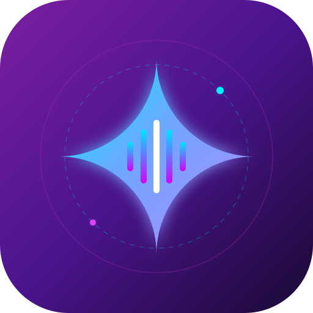

<div align="center">



# GenStation

**Умный мост между голосовым помощником Яндекс Алиса, нейросетью Google Gemini и поиском Serper**

[](https://vercel.com/new/clone?repository-url=https%3A%2F%2Fgithub.com%2Fmagic4n%2FGenStation&env=GEMINI_API_KEY,SERPER_API_KEY)

[](https://vercel.com)
[](https://aistudio.google.com)
[](https://dialogs.yandex.ru/developer)
[](./LICENSE)

[Инструкция по установке](./INSTALL.md) • [Решение проблем и FAQ](./FAQ.md)

</div>

---

## 🌟 О проекте

**GenStation** — это готовый бессерверный вебхук для Яндекс Диалогов, превращающий вашу Яндекс Станцию или приложение с Алисой в полноценного голосового ассистента на базе **Google Gemini**.

Развёртывание выполняется в пару кликов: достаточно импортировать репозиторий [https://github.com/magic4n/GenStation](https://github.com/magic4n/GenStation) в Vercel и указать ключ Gemini API.

Навык адаптирован под специфику живого диалога: он укладывается в жесткие временные рамки Алисы, очищает текст от Markdown-разметки для естественной озвучки и при необходимости ищет свежие данные в интернете через Google Serper API.

## ✨ Ключевые возможности

- 🚀 **Быстрый старт по ссылке:** просто укажите URL репозитория в Vercel без ручного скачивания архивов.
- ⚡ **Молниеносный ответ:** жесткий контроль времени исполнения (`TOTAL_RESPONSE_BUDGET_MS = 3900 мс`) для соблюдения лимита Яндекс Диалогов в 4.5 секунды.
- 🗣️ **Чистый синтез речи (TTS):** автоматическое удаление Markdown (`**`, `#`, списков, веб-ссылок) и расстановка естественных пауз на тире.
- 🌐 **Поиск в реальном времени:** интеграция с поисковой системой Serper для ответов на вопросы о курсах валют, погоде и последних новостях.
- 🧠 **Управление контекстом:** сохранение истории реплик с защитой от рассинхронизации ролей (`safeHistory`), предотвращающей ошибки Gemini API.
- 🔘 **Быстрые кнопки (Саджесты):** поддержка интерактивных подсказок на устройствах с экранами (Яндекс Станция Дуо Макс, мобильное приложение).
- 🛠️ **Нулевая стоимость поддержки:** развертывание на бесплатном тарифе Vercel Serverless Functions без необходимости аренды VPS.

---

## 🏗️ Архитектура работы

```
[ Пользователь ]
       │
       ▼ (Голос / Текст)
[ Яндекс Алиса (Диалоги) ]
       │
       ▼ (HTTPS POST /api)
[ Vercel Serverless Function (GenStation) ]
       ├── Проверка команд (Помощь / Сброс / Выход)
       ├── Определение поискового намерения (Serper API)
       └── Генерация краткого ответа (Google Gemini API)
       │
       ▼ (TTS + Text)
[ Яндекс Алиса (Озвучивание ответа) ]
```

---

## 📚 Документация и ссылки

- **[Руководство по установке (INSTALL.md)](./INSTALL.md)** — пошаговый гайд по импорту репозитория `https://github.com/magic4n/GenStation`, настройке Vercel и публикации навыка в Яндекс Диалогах.
- **[Частые вопросы и решение проблем (FAQ.md)](./FAQ.md)** — устранение ошибки `Empty Response`, настройка хранилища данных, обход тайм-аутов и региональных ограничений.

---

## 📄 Лицензия

Проект распространяется под открытой лицензией [MIT](./LICENSE).
